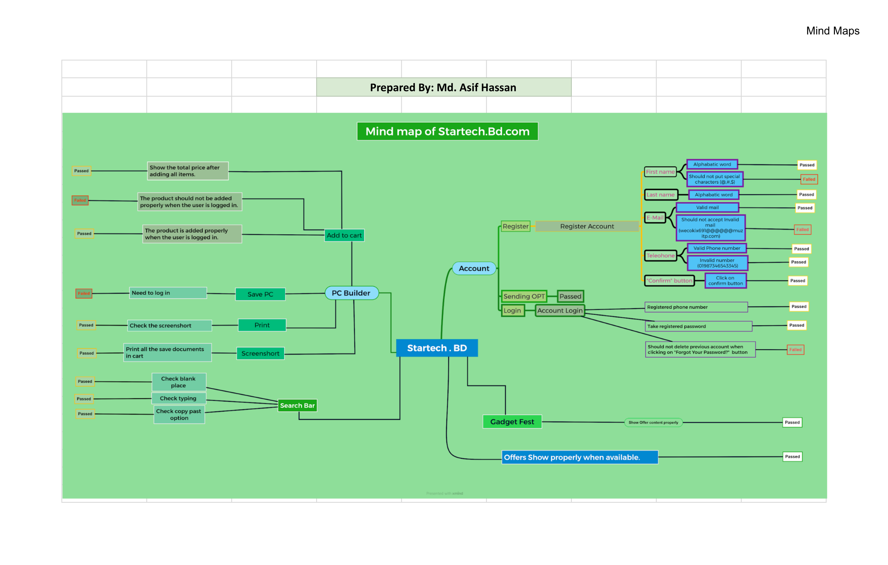
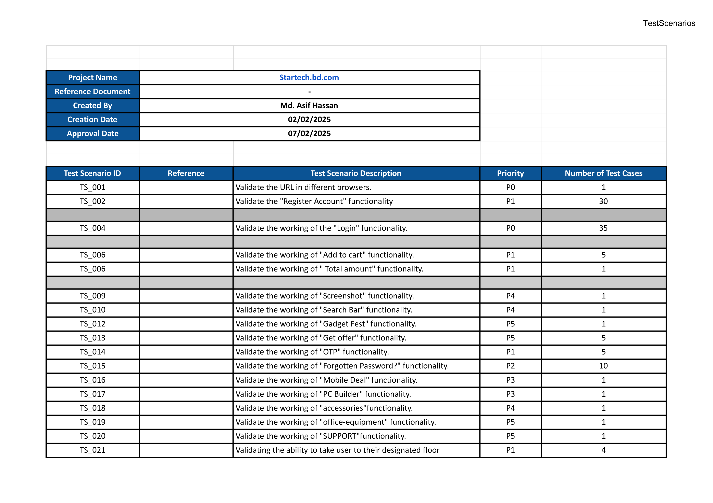
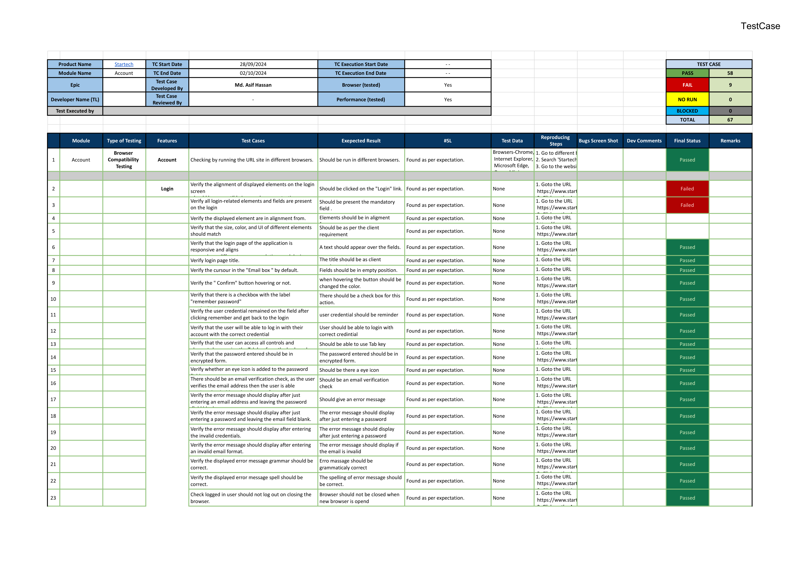
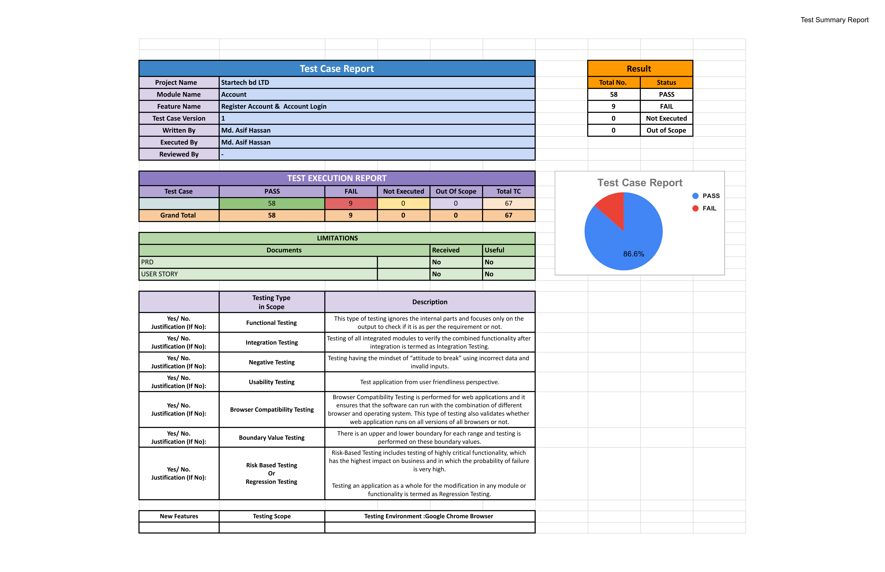
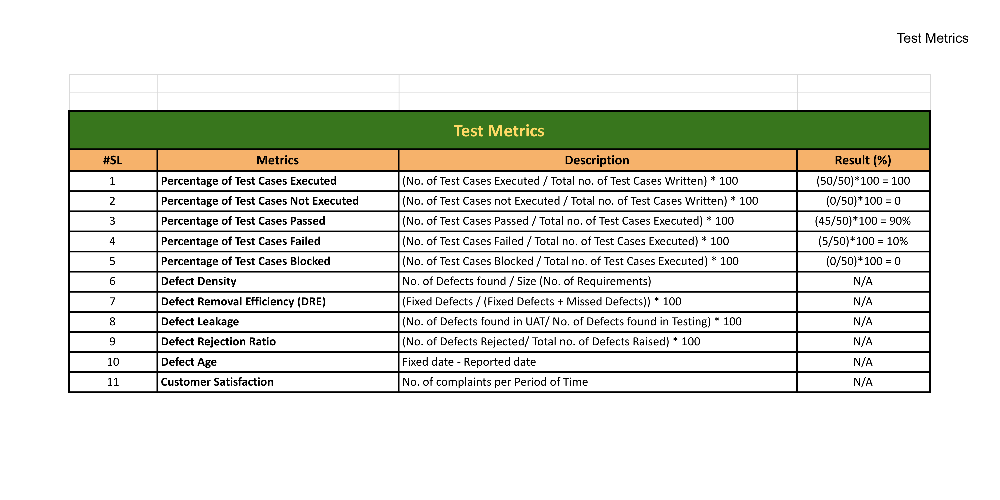
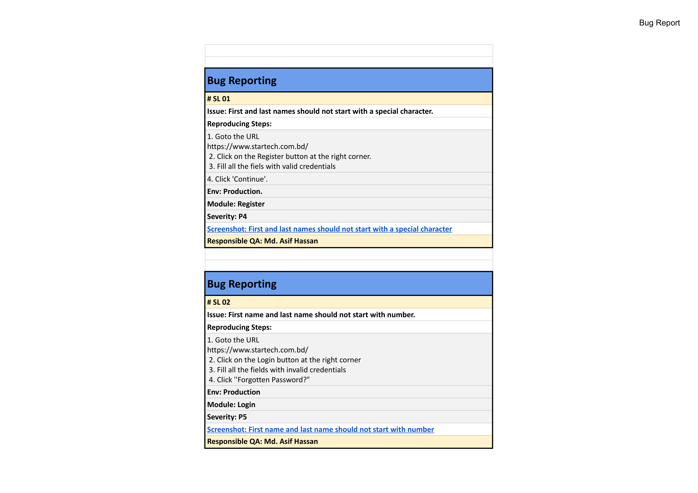

# 🚀 Manual Testing Artifacts

Manual Testing Artifacts focused on the Account Module of Startech.bd, covering Registration and Login functionality. It includes mind maps, test scenarios, test cases, bug reports, test summary reports, and test metrics, all organized in Excel. The goal is a reusable toolkit to help QA teams plan, execute, and analyze testing.

---

## 📂 Project Structure

```text
manual-testing-artifacts/
├── screenshots/                  # Test artifact screenshots
│   ├── bug-report.png
│   ├── mind-maps.png
│   ├── test-case.png
│   ├── test-metrics.png
│   ├── test-scenarios.png
│   └── test-summary-report.png
├── test-cases.xlsx               # Test cases spreadsheet
└── README.md                     # Project documentation
```

---

## 📋 Artifacts Description

Mind maps represent the Account Module, covering Registration, Login, and related functionalities. Test scenarios outline high level conditions, such as edge cases and input validation, to verify behavior. Test cases detail the steps, test data, expected results, and actual outcomes for First Name, Last Name, Email, Password, and OTP validation, using positive and negative testing.

Test summary report covers 67 test cases, including 58 passed and 9 failed, with no unexecuted or out of scope cases. Bug reports document defects with ID, issue, severity, and reproduction steps. Test metrics provide an overview of testing activities, such as execution status and pass or fail percentages.

---

## 📊 Summary

The Account Module testing achieved an 86.6% pass rate across the Registration and Login features, identifying potential issues and validating expected functionality. Defects were documented with reproduction steps, environment, module, and severity to support a stable and reliable user experience.

---

<!-- Artifact Screenshots -->
<p align="center">
  <a href="screenshots/mind-maps.png"></a>
  <a href="screenshots/test-scenarios.png"></a>
  <a href="screenshots/test-case.png"></a>
  <br><br>
  <a href="screenshots/test-summary-report.png"></a>
  <a href="screenshots/test-metrics.png"></a>
  <a href="screenshots/bug-report.png"></a>
</p>

---

## 👤 Author
Md. Asif Hassan
